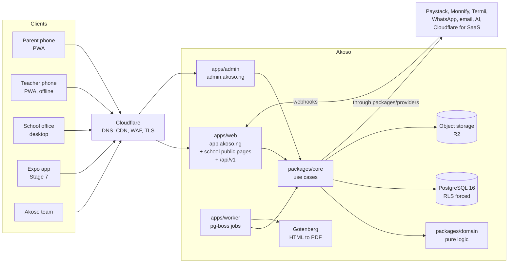
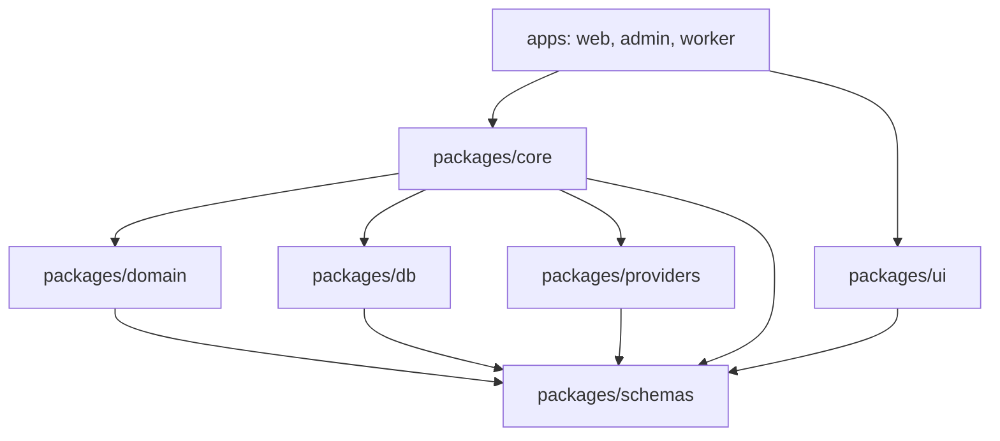
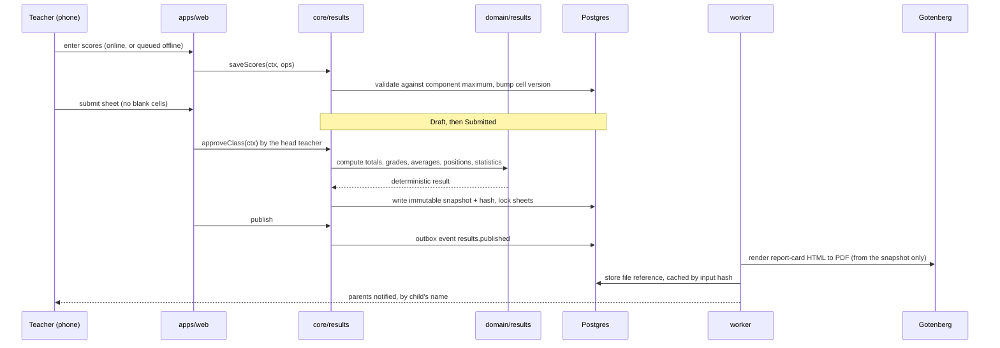
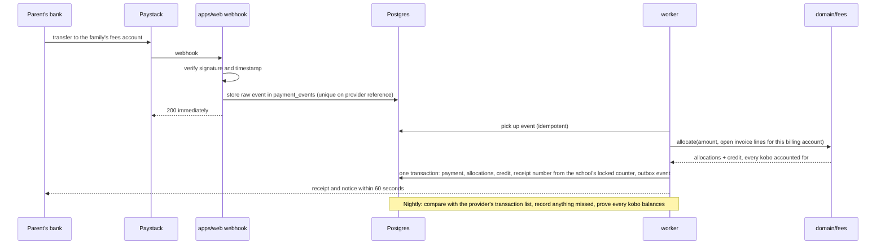

# Akoso: Architecture

How Akoso is built. Day-to-day work uses the one-page
[`ARCHITECTURE-ESSENTIALS.md`](ARCHITECTURE-ESSENTIALS.md); read this document when you
need the reasoning. The brief (`docs/MASTER_PROMPT.md`) is the source of truth; section
numbers below refer to it. An out-of-date architecture document is a bug.

**Status:** Approved by the founder on 11/11/2026 (section 3.2 checkpoint). The repository holds
an empty, building skeleton. Everything described as behaviour below is the **design to
be built**, not something that exists yet, unless marked "in place".

## 1. Shape of the system

Akoso is a **modular monolith**: one web app, one platform-admin app and one worker,
all from one codebase, all talking to one PostgreSQL database. No microservices. Module
boundaries are kept clean enough that a module could be extracted later if load demands.



## 2. Technology and why

The stack is fixed by section 2; changing any of it needs an ADR and the founder's approval.

| Choice                                     | Why                                                                                                                                               |
| ------------------------------------------ | ------------------------------------------------------------------------------------------------------------------------------------------------- |
| TypeScript, strict, end to end             | One language and one set of types from the database to the phone                                                                                  |
| Next.js App Router                         | Server components keep the parent experience small on slow connections; server actions and route handlers are thin wrappers over shared use cases |
| pnpm workspaces monorepo                   | Web, admin, worker and later the Expo app share domain logic, schemas and the API client                                                          |
| PostgreSQL 16 with row-level security      | Tenant isolation enforced by the database, not only by application code                                                                           |
| Drizzle ORM                                | Typed, parameterised queries; migrations as reviewable SQL                                                                                        |
| Zod in a shared package                    | One definition of every input and output, used by browser, server, worker and mobile                                                              |
| Better Auth                                | Phone OTP for parents; password and MFA for staff; an Expo integration for later                                                                  |
| pg-boss                                    | A job queue on Postgres: no extra infrastructure, and jobs commit in the same transaction as the data that caused them                            |
| Gotenberg                                  | Reliable HTML-to-PDF in its own container, so PDF rendering never runs in the web process                                                         |
| S3-compatible storage (Cloudflare R2)      | Tenant-prefixed keys and short-lived signed URLs                                                                                                  |
| Tailwind and shadcn/ui preset `b4bg87xLw8` | A consistent, accessible design system ([ADR 0002](adr/0002-design-system.md))                                                                    |
| Serwist and Dexie                          | Installable PWA with an IndexedDB queue for offline work                                                                                          |

Decisions are recorded in [`docs/adr/`](adr/README.md):
[0001 stack and monorepo](adr/0001-stack-and-monorepo.md),
[0002 design system](adr/0002-design-system.md),
[0003 admin as a separate app](adr/0003-admin-as-separate-app.md),
[0004 brand assets](adr/0004-brand-assets-from-brand-kit.md).

## 3. Monorepo layout (in place)

```
apps/
  web/        Next.js: the app at app.<domain> (PWA for parents and staff, school
              admin screens, /api/v1) and each school's public pages
  admin/      Next.js: the platform admin for the Akoso team, at admin.<domain>
  worker/     Background jobs: PDFs, messages, payments, domains, reminders
  mobile/     Expo foundation (Stage 7; a README only until then)
packages/
  core/       Use-case services, one folder per module
  db/         Drizzle schema (one file per module), migrations, RLS, withTenant()
  domain/     Pure logic: results, fee allocation, payroll
  schemas/    Shared Zod schemas (one file per module)
  providers/  Interfaces and adapters for every external service
  api-client/ Typed /api/v1 client generated from OpenAPI
  ui/         shadcn-based design system
  typescript-config/  Shared compiler settings
docs/         brief/ specs/ adr/ runbooks/ legal-templates/ help/ security/ and the
              documents listed in AGENTS.md
```

## 4. Modules and dependency rules

### 4.1 Layers

Dependencies point one way. `pnpm boundaries` (dependency-cruiser) fails CI on any
violation or circular import; the rules are in `.dependency-cruiser.cjs`.



| Package     | May import                             | Never imports                                              |
| ----------- | -------------------------------------- | ---------------------------------------------------------- |
| `schemas`   | nothing of ours                        | anything else; Node built-ins                              |
| `domain`    | `schemas`                              | the database, the framework, providers, UI; Node built-ins |
| `db`        | `schemas`                              | everything else                                            |
| `providers` | `schemas`, `domain`                    | `core`, `db`, UI, apps                                     |
| `core`      | `domain`, `db`, `providers`, `schemas` | Next.js, React, UI, apps                                   |
| `ui`        | `schemas`                              | `core`, `db`, `domain`, `providers`                        |
| apps        | `core`, `ui`, `schemas`, `domain`      | `db` directly; each other                                  |

`domain` and `schemas` stay free of Node-only and web-only imports so they also run in
React Native (section 5.1).

### 4.2 Feature modules

A module is the same name across three packages: use cases in
`packages/core/src/<module>/`, tables in `packages/db/src/schema/<module>.ts` and Zod
schemas in `packages/schemas/src/<module>.ts`. Its UI lives in the apps. Each module
has a `README.md` and exposes a small public interface in its `index.ts`.

| Module           | Product name  | Brief          |
| ---------------- | ------------- | -------------- |
| `identity`       | Platform      | 6, 26.2        |
| `tenancy`        | Platform      | 7, 7.1         |
| `audit`          | Platform      | 27, 28.3       |
| `school-setup`   | Setup         | 8              |
| `people`         | Setup         | 9              |
| `imports`        | Setup         | 10             |
| `results`        | Akoso Reports | 11, 12         |
| `fees`           | Akoso Pay     | 13             |
| `payments`       | Akoso Pay     | 14             |
| `payroll`        | Akoso Staff   | 15             |
| `expenses`       | Expenses      | 16             |
| `messaging`      | Akoso Parent  | 17             |
| `attendance`     | Akoso Prefect | 21             |
| `safeguarding`   | Akoso Prefect | 21             |
| `learning`       | Akoso Staff   | 19             |
| `offline-sync`   | Platform      | 20             |
| `rollover`       | Setup         | 21             |
| `admissions`     | Akoso Admit   | 22             |
| `insight`        | Akoso Insight | 23             |
| `billing`        | Platform      | 25, 25.1, 26.4 |
| `privacy`        | Platform      | 29             |
| `platform-admin` | Platform      | 26             |

Rules, both enforced by the boundary check:

- A module imports another module only through its `index.ts`.
- A module's services use only that module's schema file
  (`@akoso/db/schema/<module>`). To reach another module's data, call its services.

Modules talk to each other through service calls or **domain events** written to an
outbox table in the same transaction and handled by the worker (for example
`payment.allocated` → send the receipt). No hidden side effects in unrelated functions.

### 4.3 One way of doing each thing

One pattern each for services, API handlers, forms, background jobs and errors,
documented in `AGENTS.md` with a tiny example in `ARCHITECTURE-ESSENTIALS.md`. The
patterns are finalised with the first slice that needs each; until then the essentials
file states the intended shape.

## 5. Tenancy (section 7)

One school must never see or change another school's data. This is the top risk.

- One shared schema. Every tenant-owned table has `tenant_id uuid NOT NULL`, first in
  every composite index.
- RLS is **enabled and forced** on every tenant table, with both `USING` and
  `WITH CHECK` policies.
- Every database access goes through `withTenant(tx, tenantId)`, which sets the tenant
  for that transaction with `set_config('app.tenant_id', $1, true)`. Never a plain `SET`.
  A query with no tenant set returns no rows.
- The application role has no SUPERUSER or BYPASSRLS. Migrations run under a separate
  role. Further roles for the worker and read-only reporting follow least privilege.
- Server-side authorisation runs in every server action and route **in addition to**
  RLS. RLS is the last line of defence, not the only one.
- **The isolation suite** (`packages/db/src/isolation/`) finds every table with a
  `tenant_id` from the database catalog. For each, it checks forced RLS, a `USING` +
  `WITH CHECK` policy, `tenant_id` first in multi-column indexes and a foreign key to
  `platform.tenants`. It then proves school B cannot read, insert, update, delete or move
  school A's rows. A table without a row fixture in `isolation/fixtures.ts` fails it.
  Runs on every pull request.
- Files follow the same rule: object keys are prefixed with the tenant ID and every
  download goes through an authorised signed URL valid for 15 minutes at most.
- A **group** sits above schools so one owner can run several branches. A branch is a
  school in a group; there is no separate branches table (D-21).
- Schools (`platform.tenants`) and groups are platform tables the app role cannot read.
  It reaches them only through `platform.tenant_by_slug/_id/_host()`, which return the
  public fields. A school's `status` (onboarding, active, suspended, read_only, closed)
  is applied to every request by the pipeline.

### Addresses

| Address                              | Serves                                                                                        | Auth cookie                |
| ------------------------------------ | --------------------------------------------------------------------------------------------- | -------------------------- |
| `app.<domain>`                       | The signed-in app for parents and staff, server actions, `/api/v1`                            | Yes, on this host only     |
| `admin.<domain>`                     | The platform admin (`apps/admin`)                                                             | Its own, on this host only |
| `<slug>.<domain>` or a custom domain | A school's public pages: admissions form, document and receipt verification, a sign-in button | Never                      |

After sign-in the person picks a school, and **the school travels in the address**:
`app.<domain>/<slug>/...` (D-21), or the `X-Akoso-School` header for the mobile app. It
is checked against the user's memberships on every request; a non-member gets 404. The
request proxy (`apps/web/proxy.ts`) classifies the Host header, serves a school's public
pages on its own address (no cookies, no service worker, no app routes), and returns 404
for an unknown host, never a default school. The base domain comes from
`APP_BASE_DOMAIN`.

## 6. Data model overview (section 27)

Tables are grouped by module (the module READMEs list them). Conventions:

- UUID primary keys; foreign keys; unique constraints; indexes led by `tenant_id`.
- `created_at`, `updated_at`, `created_by` on every table.
- Money is integer **kobo**. Never floating point.
- Moments are `timestamptz` in UTC. Date-only values are plain dates. Every "today",
  deadline and report period is computed in the school's time zone (default
  `Africa/Lagos`), never the server's or the phone's.
- **Append-only** tables: payments, allocations, refunds, credit-ledger entries, result
  snapshots, payslips, audit events. The database enforces it (the app role has no
  `UPDATE` or `DELETE` on them). Corrections are new entries that reference the original.
- Soft deletion only for students and staff, never for money.
- Encrypted columns for staff bank details and national identifiers (NIN, LIN).
- Migrations are backward compatible: expand, migrate data, then contract.
- Part 2 modules are added with additive migrations only.

Three models carry most of the design weight:

- **Family vs billing account.** A family decides who sees what; a billing account
  decides who is invoiced and receives receipts. A family has one billing account by
  default; split payers and sponsors have their own. Invoice lines are assigned to
  billing accounts, and each billing account has one dedicated (fees) account.
- **Enrolment history.** One record per student per term, so class history, results and
  fees stay correct after promotion.
- **Snapshots.** Approval writes an immutable snapshot of totals, grades, positions,
  statistics and the scheme versions used. Published report cards render only from it.

## 7. Key flows

### 7.1 Score entry to report card (sections 11, 12, 20)



- Computation is pure and deterministic in `packages/domain/results`, tested against
  golden files from 5 schools.
- Only the head teacher can unlock an approved sheet. Every later change is audited with
  a reason and recomputes the whole arm. Unlocking after publishing needs a second person.
- Later edits to schemes never change a published result.

### 7.2 Transfer to receipt (section 14)



- Money settles from the provider straight to the school's account. Akoso never holds
  school funds.
- Allocation: oldest unpaid invoice first; mandatory lines before optional; only lines
  that billing account is responsible for. Overpayment becomes family credit.
- Unmatched transfers go to a queue; payments are never edited or deleted. Moves,
  refunds and reversals are linked new entries.
- Receipt numbers come from one counter per school, locked in the same transaction, so
  the sequence has no gaps or duplicates.

### 7.3 Offline sync (section 20)

```mermaid
sequenceDiagram
  participant U as Teacher (offline)
  participant IDB as IndexedDB (Dexie)
  participant SW as Service worker
  participant S as core/offline-sync
  participant DB as Postgres
  U->>IDB: save op {clientId, cell, value, baseVersion}
  Note over U,IDB: Indicator shows offline + number of unsynced changes
  SW-->>U: app shell, class lists and score sheets from cache
  U->>S: reconnect: send ops in order
  S->>S: re-validate each op: permissions, maximums, locked state
  alt server version == baseVersion
    S->>DB: apply, version + 1
  else server version moved on
    S->>DB: later-received change wins; overwritten value kept for conflict review
  end
  S-->>U: per-op result; queue cleared only after success
```

- The server's receive order decides conflicts. A phone's clock is never trusted.
- No score is ever silently lost: the overwritten value goes to a conflict review screen
  for the head teacher.
- Client-generated IDs make every operation idempotent, so a retry never duplicates.
- If the sign-in expires while offline, queued work stays on the phone until the teacher
  signs in again. Approved sheets cannot be changed offline.
- Offline data is scoped to the signed-in user and cleared on sign-out.

## 8. Integrations (section 2)

Every external service sits behind an interface in `packages/providers`, with a fake
adapter for tests and local development. Swapping a provider never touches business
logic. Until the founder's accounts and approvals arrive (section 32.2), the build uses
test modes, log-only adapters and a clearly labelled development payment adapter.

| Interface      | Primary                                                                    | Backup                                | Until live                                                      |
| -------------- | -------------------------------------------------------------------------- | ------------------------------------- | --------------------------------------------------------------- |
| Payments       | Paystack (dedicated accounts, subaccounts, splits, checkout, direct debit) | Monnify reserved accounts             | Paystack test mode; development adapter that simulates webhooks |
| SMS            | Termii, DND route                                                          | Africa's Talking                      | Log-only adapter                                                |
| WhatsApp       | Meta WhatsApp Cloud API, utility templates                                 | SMS fallback after 10 minutes         | Log-only adapter                                                |
| Email          | Resend or Amazon SES                                                       |                                       | Log-only adapter                                                |
| Push           | Web push (VAPID); Expo push                                                | WhatsApp or SMS for critical messages | Local VAPID keys                                                |
| PDF            | Gotenberg container                                                        |                                       | Local container                                                 |
| AI drafts      | Claude or Gemini (open decision)                                           |                                       | Fake adapter; no names or identifiers ever sent                 |
| Custom domains | Cloudflare for SaaS                                                        |                                       | Fake adapter                                                    |
| Storage        | Cloudflare R2                                                              |                                       | none yet (ADR 0005)                                             |

## 9. Background jobs

The worker runs pg-boss on Postgres. Long or heavy work never runs in a web request.

- PDFs (report cards, receipts, payslips, ID cards), bulk invoice runs, imports,
  messaging and fallbacks, webhook processing and allocation, nightly reconciliation and
  the kobo-balance proof, payout matching, platform-fee split switching, custom-domain
  checks, reminders, the daily audit-chain verification, data exports.
- Every job is idempotent and retryable, tracks progress, and carries the request ID
  that started it so one ID follows a request from browser to API to worker.
- Schedules respect each school's time zone, calendar and quiet hours.

## 10. API and mobile readiness (section 5.1)

- Every use case is a service function in `packages/core` taking an authenticated
  context (user, tenant, roles). Server actions and route handlers are thin wrappers.
- A versioned REST API at `/api/v1` for parent and teacher use cases: Zod-validated
  input and output, a consistent error format, pagination (cursor-based for large
  tables), idempotency keys on writes and rate limits. Published versions never break;
  breaking changes go to `/api/v2`.
- An OpenAPI document is generated from the contracts (`pnpm api:openapi`), and
  `packages/api-client` is a typed client built from the same contracts.
- Built in Stage 1 item 3: see `docs/specs/stage-1-api-and-service-conventions.md` and
  `packages/core/src/kernel/`.

## 11. Errors and logging

- A small set of typed application errors (`ValidationError`, `NotFoundError`,
  `ForbiddenError`, `ConflictError`) mapped to consistent API responses and friendly
  messages in the Akoso voice. Expected failures in domain code return results;
  unexpected failures throw. No error is swallowed.
- Structured JSON logs with tenant ID, user ID, request ID and job ID on every line, and
  no personal data, tokens or health details.

## 12. Security architecture (section 28)

Security is part of every slice. Targets: OWASP Top 10, ASVS Level 2 with selected
Level 3 controls for authentication, sessions, payments, payroll, results approval and
the platform admin, the OWASP API Security Top 10, and MASVS for the Expo app.

- **Server is the only source of truth.** Totals, grades, positions, balances, prices,
  discounts, roles and tenant IDs are always recomputed or re-checked on the server.
- **Central permission check** on every operation, generated tests from
  `docs/permissions.md`. Hiding a button is not access control.
- **Tamper evidence.** Append-only money and results tables; a hash-chained audit log
  verified daily and copied to write-once storage; a stored hash of each published
  snapshot; a verification QR code on report cards, transcripts and receipts.
- **Two-person control** for unlocking published results, large discounts and
  write-offs, refunds above a threshold, payroll approval, settlement-account changes
  and bulk deletions.
- **Webhooks:** signature and timestamp verified, replay rejected, raw event stored
  before processing.
- **No card data** ever touches Akoso; checkout uses the provider's hosted page.
- **Headers and transport:** strict CSP, HSTS, X-Content-Type-Options, Referrer-Policy,
  Permissions-Policy; TLS everywhere; field-level encryption for bank details and
  national IDs.
- **Akoso staff** follow least privilege and see a school's data only through a
  consented, time-limited, fully logged support session.
- **Supply chain:** committed lockfile, frozen installs in CI, GitHub Actions pinned to
  commit SHAs (in place), secret scanning (in place), with SAST, dependency, container
  and dynamic scans added as Stage 1 continues.

Threat models, the ASVS checklist and the pre-launch checklist live in `docs/security/`.

## 13. Environments and deployment (section 31)

| Environment | Where                                                                                                      | Data                           |
| ----------- | ---------------------------------------------------------------------------------------------------------- | ------------------------------ |
| dev         | Local Docker Compose: Postgres 16, PgBouncer, Gotenberg (in place); object storage chosen later (ADR 0005) | Synthetic seed data            |
| staging     | Production-like containers and managed Postgres                                                            | Synthetic only                 |
| production  | Containers on a managed platform, managed Postgres with point-in-time recovery, Cloudflare in front        | Real; agents never have access |

- Web, admin and worker are stateless; sessions, files, jobs and caches live in
  Postgres, object storage or a cache service.
- CI on every pull request: format, typecheck, lint, tests, import boundaries, unused
  code, build and a secret scan (in place); automatic deploy to staging; manual approval
  to production; one-click rollback.
- Feature flags per tenant for gradual rollout. No production deploys during any
  school's results week or resumption week.
- Backups: point-in-time recovery, a nightly encrypted export to a second region,
  object-storage versioning. Recovery point 15 minutes, recovery time 4 hours, a restore
  drill every term.
- Hosting: Render, Frankfurt region (D-18). Postgres is Render Postgres with its built-in
  PgBouncer in transaction mode; Gotenberg is a private service on Render's private network.

## 14. Hard questions

Asked before any feature code, as section 3.2 requires. Answers that leave something
open are also listed in [`risks.md`](risks.md).

### What will break first at 50 schools?

Results week. Schools in one state publish in the same days, so PDF rendering and
notification sending spike together. Design: PDFs render only in the worker, cached by a
hash of their inputs, with per-tenant concurrency limits so one school cannot starve the
rest; Gotenberg scales as its own container. The budget (600 cards in under 10 minutes)
is load-tested with many schools at once before the pilot gate. Second to break is the
founder's own support time, which the in-app help, onboarding checklists and health
alerts exist to protect.

### At 500?

- **The Paystack dedicated-account limit** (1,000 by default) is passed at the second
  or third school, long before 500. It is tracked per environment with an alert, and the
  increase is a founder task before the second school.
- **Platform-fee split switching** becomes hundreds of percentage changes a term. It is
  a queued, idempotent job per school with a per-school lock, and has an emergency pause.
- **Large tables** (`scores`, `payment_allocations`, `audit_events`,
  `message_deliveries`). Every row carries `tenant_id` first in its indexes so tables can
  be partitioned later without a rewrite; heavy reports can move to a read replica.
- **Resumption week**: a design target of 1,000 webhooks a minute. The webhook handler
  only verifies, stores and returns 200; the work happens in the worker.
- **One WhatsApp number and one SMS sender ID** shared by all schools: a rate limit or a
  quality downgrade affects everyone. Mitigated by per-tenant rate limits, the
  SMS fallback and the emergency pause; per-school numbers are a later option.

### What happens when Paystack, Termii or WhatsApp is down?

- **Paystack:** transfers into fees accounts are held by the banks and Paystack and
  arrive late; nothing is lost because the webhook inbox is idempotent and the nightly
  job reconciles against the provider's list. The parent app shows the school's own bank
  account as an alternative. The owner can switch collection to Monnify with an
  emergency switch, following a runbook. Bank-statement import keeps working throughout.
- **Termii:** OTP sign-in is the dependency that hurts. WhatsApp OTP and a parent's
  backup number or email are alternatives; Africa's Talking is the backup SMS adapter.
- **WhatsApp:** critical messages fall back to SMS after 10 minutes; everything is in
  the app and by push regardless.

### When two teachers edit the same score offline?

See 7.3. Each edit carries the version it started from. The change the server receives
later wins, the overwritten value is kept and shown to the head teacher for review, and
no phone clock is consulted. Each sheet normally has one subject teacher, so this is
rare, but it is designed for and tested.

### When a webhook arrives twice, late or out of order?

- **Twice:** the inbox has a unique constraint on the provider reference; the second
  insert is a no-op and still returns 200.
- **Late:** the payment is dated when the parent paid, from the provider's data, so it
  lands on the right day, term and report. If it never arrives, nightly reconciliation
  records it.
- **Out of order:** each event is applied as a state transition that is valid from the
  current state, and events that only make sense later (a reversal before its payment)
  are retried with backoff until their predecessor exists.

### When a parent pays the wrong amount into the wrong account?

- **Wrong amount:** part payment is allocated oldest invoice first and the balance
  stays; overpayment becomes family credit applied to the next invoice.
- **Wrong account:** the money is credited to that account's family, because that is
  where the bank sent it. The bursar uses "Move payment" with a reason and evidence
  (and a second approver above a set amount): Akoso reverses the original allocations,
  creates new ones, cancels and replaces the receipt, and notifies both families. Nothing
  is edited or deleted.

### When a school changes its grading scheme mid-term?

Schemes are versioned data. A change creates a new version; published results keep
rendering from their snapshot, which records the scheme versions used. Unpublished
sheets recompute against the new version, with a warning showing which classes are
affected. **Open:** whether a change to an _assessment_ scheme (component maximums)
after scores have been entered is blocked, or allowed with every out-of-range score
flagged. See `docs/decisions.md`.

### When the database or a worker crashes mid-job?

- Every multi-row money or results operation runs in one transaction: it happens
  completely or not at all.
- pg-boss jobs are retried after a visibility timeout; every job is idempotent, so a
  retry after a half-finished attempt is safe.
- Outbox events are written in the same transaction as the change they describe, so a
  receipt is never promised for a payment that was rolled back.
- Receipt numbers come from a counter locked in the same transaction, so a failed
  transaction never uses one up.
- Database loss: point-in-time recovery with a 15-minute recovery point.

### What could let one school see another's data?

In order of how likely we think each is:

1. **A new table without RLS.** The isolation test enumerates every table from the
   database catalogue and fails if one lacks forced RLS with both policies.
2. **A query outside `withTenant()`.** No tenant set means no rows; the app role cannot
   bypass RLS; there is one sanctioned way to open a transaction.
3. **A connection-pool leak** of the tenant setting between requests. `set_config(...,
true)` is transaction-scoped, so it cannot outlive its transaction. Tested with a
   pooled connection reused across two tenants.
4. **Guessing an ID.** Every lookup is tenant-scoped and permission-checked; a
   cross-tenant ID returns "not found".
5. **Files.** Keys are tenant-prefixed and every download is an authorised signed URL.
6. **Caches.** Every cache key includes the tenant ID. The host-to-tenant cache is
   invalidated on domain change.
7. **Background jobs.** Each job carries its tenant ID and runs inside `withTenant()`.
8. **Akoso staff and support sessions.** Consented, time-limited, view-only by default
   and logged on both sides.
9. **Platform-wide reports** (the founder's dashboard, the platform-fee ledger) read
   only figures that a job published, school by school inside `withTenant()`, into
   the `platform` schema (decision D-7). No role bypasses RLS.
10. **Logs, error reports and analytics.** No personal data in logs; tenant ID only.
11. **The AI provider.** No names or identifiers are sent.
12. **Shared WhatsApp and SMS senders.** Every message starts with the school's name,
    and recipients are resolved inside the tenant.
